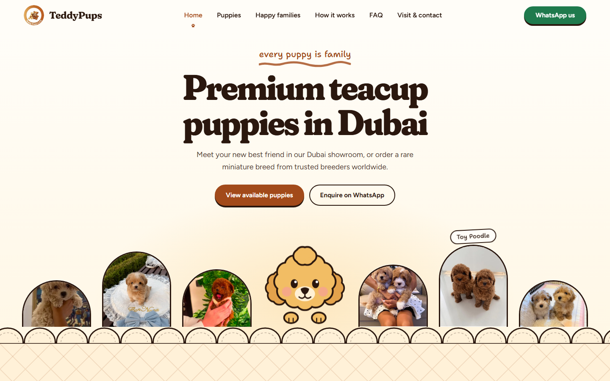

# Puppy Website Clone

A responsive full stack clone of [puppy.instabizweb.com](https://puppy.instabizweb.com/), built as the technical assignment for the Full Stack Developer role at Insta Biz Web.

**Loom walkthrough:** [ADD LOOM URL]



## Overview

This project recreates the design, layout, responsiveness and functionality of the reference website (TeddyPups U.A.E., a teacup puppy brand in Dubai). The layout, styling, scroll animations and illustrations (including the little poodle mascot) are rebuilt from scratch with my own code. It has a React frontend and a Node.js/Express backend connected to a MySQL database. Forms are validated on the client and on the server, and every submission is stored in MySQL.

All the content the pages show (puppies, photos, FAQ, testimonials, "how it works" steps, contact details) is read from the database through the REST API, so nothing is hard coded in the components.

## Features

- Close visual match of the reference site: fonts, colours, scalloped edges, hand-drawn doodles, sticker buttons
- Fully responsive for desktop, laptop, tablet and mobile (separate mobile menu, bottom WhatsApp / Call bar and a two-column puppy grid on phones)
- **Home page**: hero with cycling puppy photos, a scroll-driven "Meet the pups" door shelf (doors open as the mascot walks past), "Two ways to meet your puppy", a sticky phone that tells the WhatsApp journey step by step, the puppy passport with stamps, happy-family polaroid wall, FAQ teaser and a "welcome home" call to action
- **Puppies page**: filters for where (everywhere / imported / Korean teacup), breed and boy or girl, kept in the URL so links can be shared; live count; "Already gone home" strip
- **Puppy page**: photo gallery with arrows, counter and thumbnails, info card, what comes with every pup, "the way home" steps for imported puppies, enquiry form and previous / next puppy
- **Gone home**: a wall of "admit one" ticket cards
- **Happy families**: 64 polaroids, testimonial and photo counter
- **How it works**: In Dubai / Imported toggle, step cards, premium promise, delivery and collection, why choose us
- **FAQ**: pin-board of accordions with a live search box
- **Contact**: the "Dear TeddyPups" fill-in-the-blanks letter, WhatsApp / call / email and a map link
- Forms with client and server validation, loading, success and error states, a hidden spam-trap field and rate limiting
- REST API that saves form submissions to MySQL
- Respects `prefers-reduced-motion` (no scroll-jacking, no floating animations)
- SEO basics: page titles, meta descriptions, semantic HTML, alt text, skip link, keyboard-friendly accordions and gallery

## Tech Stack

| Area | Technology |
| --- | --- |
| Frontend | React 19 (Vite 8) |
| Styling | Tailwind CSS v4 |
| Routing | React Router 7 |
| Icons / fonts | lucide-react, Fraunces, Figtree and Shantell Sans (Fontsource) |
| Backend | Node.js with Express 5 |
| Database | MySQL (mysql2 driver) |
| Validation | express-validator (server) and matching rules in the React forms |
| Security | helmet, cors, express-rate-limit, parameterised SQL queries |
| Version control | Git and GitHub |

## Project Structure

```
├── client/                          # React frontend
│   ├── public/
│   │   ├── images/                  # logo, puppy photos, happy-family photos
│   │   └── screenshot.png
│   └── src/
│       ├── components/
│       │   ├── layout/              # Navbar, Footer, MobileBar, ScrollToTop
│       │   ├── sections/            # Hero, MeetPups, TwoWays, Journey, Passport, HappyFamilies,
│       │   │                        # FaqTeaser, FinalCta, Gallery, EnquiryForm, GoneStrip
│       │   └── ui/                  # Mascot, Doodles, PuppyCard, Field, Reveal, ApiState
│       ├── context/                 # SiteContext (contact details from the API)
│       ├── hooks/                   # useApi, usePageMeta, useInView, useLetterForm, ...
│       ├── lib/                     # site constants, form validation
│       ├── pages/                   # Home, Puppies, PuppyDetail, GoneHome, HappyFamilies,
│       │                            # HowItWorks, Faq, Contact, NotFound
│       ├── services/api.js          # all API calls (fetch)
│       ├── styles/                  # art.css, home.css, pages.css, detail.css, gone.css, inner.css
│       ├── App.jsx
│       ├── index.css                # Tailwind + design tokens
│       └── main.jsx
├── server/                          # Node.js + Express backend
│   ├── config/db.js                 # MySQL connection pool
│   ├── controllers/                 # puppies, content, forms
│   ├── routes/index.js              # routes + validation rules
│   ├── middleware/                  # error handler, validation, rate limit
│   ├── database/
│   │   ├── schema.sql               # table definitions
│   │   ├── seed.sql                 # all the website content
│   │   ├── puppy_clone.sql          # schema + seed in one file (for Workbench / phpMyAdmin)
│   │   └── setup.js                 # npm run db:setup
│   ├── app.js
│   └── server.js
├── PROMPTS.md                       # AI prompts used during development
├── .env.example
└── README.md
```

## Getting Started

### Prerequisites

- Node.js 18 or higher (developed on Node 24)
- npm
- MySQL 8 or higher (5.7 also works). Any of these gives you a MySQL server on Windows: [MySQL Installer](https://dev.mysql.com/downloads/installer/), XAMPP or Laragon. Make sure the MySQL service is running.

### Install

```bash
npm run setup
```

This runs `npm install` in the root, `server` and `client` folders.

### Configure

```bash
# macOS / Linux
cp .env.example server/.env
cp client/.env.example client/.env

# Windows (PowerShell)
Copy-Item .env.example server\.env
Copy-Item client\.env.example client\.env
```

Open `server/.env` and put your MySQL password in `DB_PASSWORD` (leave it empty if your root user has no password, like the XAMPP default). `client/.env` can stay as it is: during development Vite forwards `/api` to the backend.

### Create the database

```bash
npm run db:setup
```

This creates the `puppy_clone` database, all tables and every row of content. It drops and re-creates the tables, so running it again resets the data.

Prefer a visual tool? Import `server/database/puppy_clone.sql` in MySQL Workbench, phpMyAdmin or HeidiSQL, or run:

```bash
mysql -u root -p < server/database/puppy_clone.sql
```

### Run locally

```bash
# both at once: API on http://localhost:5000 and website on http://localhost:5173
npm run dev
```

The root development command starts both apps directly with Node.js instead of launching nested `npm` commands through a shell. This avoids Windows `spawn cmd.exe ENOENT` errors from development process managers. Stopping either app also stops the other.

or in two terminals:

```bash
# Terminal 1: backend (http://localhost:5000)
cd server
npm run dev

# Terminal 2: frontend (http://localhost:5173)
cd client
npm run dev
```

Open <http://localhost:5173>. A quick health check for the API is <http://localhost:5000/api/health>.

### Environment Variables

Add these to `server/.env` (never commit real secrets):

| Variable | Description |
| --- | --- |
| `PORT` | Backend port (for example 5000) |
| `DB_HOST` | MySQL host (for example localhost) |
| `DB_PORT` | MySQL port (3306 by default) |
| `DB_USER` | MySQL username |
| `DB_PASSWORD` | MySQL password |
| `DB_NAME` | Database name (puppy_clone) |
| `CLIENT_URL` | Frontend URL(s), for CORS (comma separated when there are several; defaults to localhost and the deployed Vercel site) |

Add this to `client/.env`:

| Variable | Description |
| --- | --- |
| `VITE_API_URL` | Backend API URL. Leave empty to use the local Vite proxy in development and the Render API in production |

### Build for production

```bash
npm run build      # builds client/dist
npm start          # the Express server serves the API and the built website on one address
```

## Database

Eleven tables and one view (see `server/database/schema.sql`):

| Table | What it holds |
| --- | --- |
| `breeds` | Maltipoo, Pomeranian, Poodle, Cavapoo, Shih Tzu ... (also drives the filter chips) |
| `puppies` | One row per puppy: slug, name, breed, sex, age, origin (local / imported), teacup flag, status (available / gone home) |
| `puppy_images` | Photos of each puppy, with a flag for the video poster |
| `faqs` | Questions and answers (`show_on_home` marks the three on the home page) |
| `testimonials` | Client quotes |
| `family_photos` | The happy-family polaroids and captions |
| `journey_steps` | The three steps of the home-page phone story |
| `trust_points` | The four stamps of the puppy passport |
| `site_settings` | Brand name, phone, WhatsApp, email, address, social links |
| `enquiries` | Submissions of the "Ask about ..." form on a puppy page (linked to the puppy) |
| `contact_messages` | Submissions of the "Dear TeddyPups" letter on the contact page |
| `v_inbox` (view) | Both kinds of submissions in one list, newest first |

To read the submissions: `SELECT * FROM v_inbox;`

## API

Base path `/api`. Every response is JSON with a `success` flag.

| Method | Endpoint | Purpose |
| --- | --- | --- |
| GET | `/health` | Server and database status |
| GET | `/settings` | Contact details and brand settings |
| GET | `/home` | Everything the home page needs in one request |
| GET | `/puppies` | List; filters `status`, `origin`, `breed`, `sex`, `teacup`, `limit` |
| GET | `/puppies/:slug` | One puppy with images and previous / next |
| GET | `/faqs` | All FAQ entries |
| GET | `/testimonials` | Testimonials |
| GET | `/family-photos` | Happy-family photos |
| POST | `/enquiries` | Save an enquiry about a puppy |
| POST | `/contact` | Save a contact letter |

Invalid form input answers `422` with a message per field. A hidden `website` field is a spam trap, and form posts are limited to 10 per 15 minutes per address.

## Deployment

The frontend is deployed on Vercel and the Express API on Render:

- The production frontend defaults to `https://puppy-instabiz.onrender.com/api`; set `VITE_API_URL` in Vercel only if the API address changes. The client adds `/api` automatically if you enter only the Render service URL.
- The Render API allows `https://puppyinstabiz.vercel.app` and `http://localhost:5173` by default. Set `CLIENT_URL` in Render to allow additional comma-separated origins, such as a custom frontend domain.
- Configure the MySQL connection variables (`DB_HOST`, `DB_PORT`, `DB_USER`, `DB_PASSWORD`, and `DB_NAME`) in Render. Do not put database credentials in Vercel or in client-side variables.
- Redeploy the Vercel frontend after changing its environment variables.

## Testing

Tested manually on:

- Chrome (desktop and a mobile emulation)
- Screen widths: 1440px (desktop) and 390px (phone)
- All links, buttons and forms (valid and invalid input), the FAQ search, the puppy filters and the 404 pages
- Every page was also compared side by side with the reference site

The API and the SQL scripts were additionally checked with scripted tests: all `.sql` files and every query used by the API are parsed with a MySQL parser, and the API endpoints (filters, validation errors, honeypot, rate limit, saved rows) were exercised against a stand-in database before connecting to MySQL.

## AI Tools Used

I used AI tools to speed up development and then reviewed and edited the generated code myself.

- Tools: Claude (Claude Code)
- All important prompts, including the master prompt, are documented in [PROMPTS.md](./PROMPTS.md).

## Challenges and Solutions

- **Reproducing the scroll-driven "Meet the pups" shelf:** the section is tall and contains a sticky, full-height stage. The page scroll position is mapped to a horizontal translation of the door row, and a door opens when it passes the mascot. It uses `requestAnimationFrame` and passive listeners, and falls back to a plain grid on phones and for people who prefer reduced motion.
- **Custom CSS fighting Tailwind utilities:** un-layered custom CSS always beats Tailwind v4 utilities, so a class like `md:hidden` stopped working. All custom CSS is now imported into the `components` layer (`@import './styles/art.css' layer(components)`), which keeps utilities in charge.
- **Getting the reference photos and fonts:** images were saved locally (optimised WebP) so the site works offline and does not hot-link the original server. Fonts come from the Fontsource packages.
- **Working without a MySQL server on the development machine:** the schema and seed are plain, portable MySQL (InnoDB, utf8mb4), all statements are parsed with a MySQL parser, and the whole API was run against a stand-in database before documenting the MySQL steps above.

## Known Limitations and Future Improvements

- The puppy photos, brand name and contact details are the public ones shown on the reference website and belong to that business. They are used here only so the clone can be compared like for like.
- The reference site plays short videos for some puppies. This clone shows the video's poster picture and the play button opens WhatsApp to ask for the clip.
- Form submissions are stored in MySQL but there is no admin dashboard yet (read them with `SELECT * FROM v_inbox;`)
- Add automated tests and run them in CI
- Add real e-mail or WhatsApp notifications when a form is submitted
- Further image optimisation (responsive `srcset` sizes)

## Disclaimer

This project was created only for evaluation purposes as part of a job assignment. All design credit belongs to the original reference website.

## Author

**Jensi**
Full Stack Developer
GitHub: [ADD GITHUB PROFILE] | LinkedIn: [ADD LINKEDIN]
